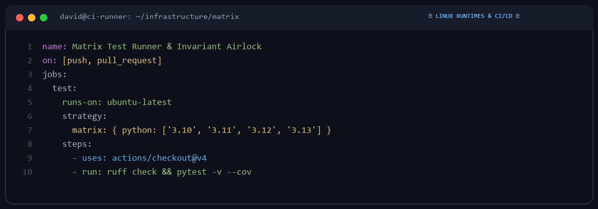

# David Vance

  

Systems & infrastructure engineer based in London, UK.  
Focusing on Linux runtimes, CI/CD pipeline automation, containerization, and reproducible build systems.

---

### 🔧 Core Areas

| Area | Tools & Technologies |
|---|---|
| **CI / CD Automation** | GitHub Actions workflows, reusable actions, matrix runners |
| **Container Runtimes** | Docker, OCI containers, multi-stage builds, minimal base images |
| **Packaging & Tooling** | Python packaging, wheel building, virtual environment isolation |

---

### 🛡️ Infrastructure Principles

1. **Hermetic & Reproducible**: Pinning dependencies and base layers for deterministic environments.
2. **Fast Feedback Loops**: Caching test fixtures and pre-compiling native extensions to reduce CI runtime.
3. **Automated Hygiene**: Linters, type-checkers, and security scanners running as non-negotiable gates.

---
*Linux • GitHub Actions • Docker • Python Packaging • Bash*